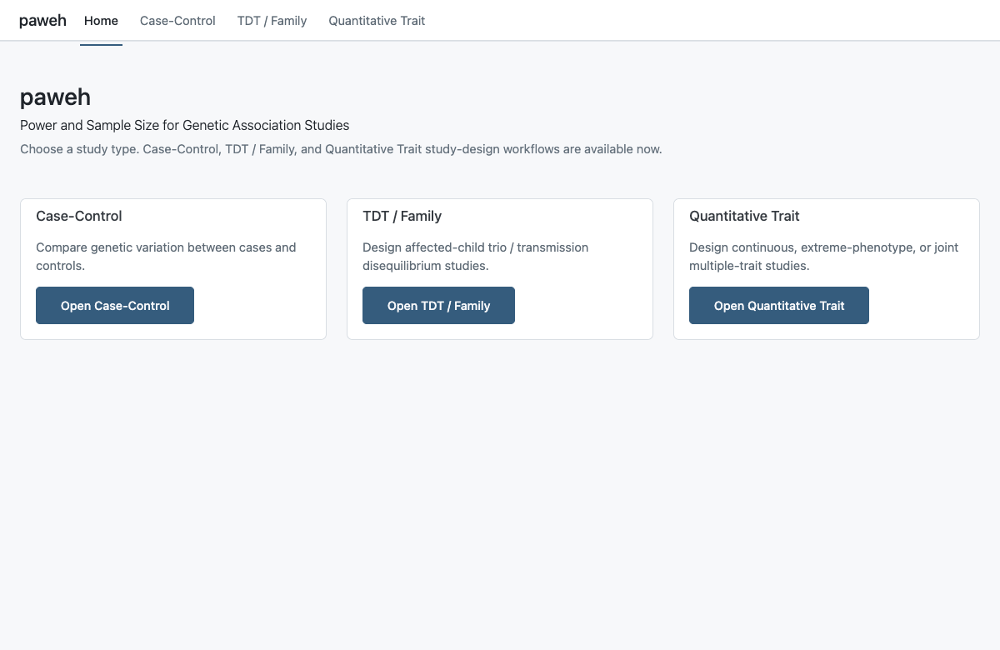
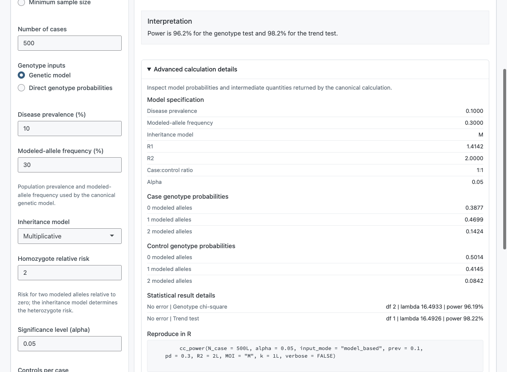
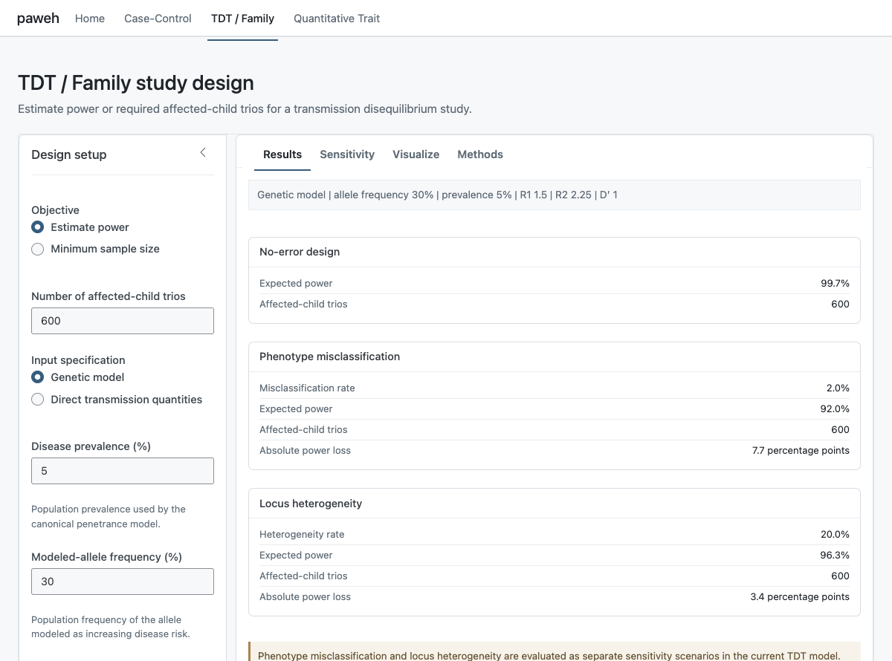
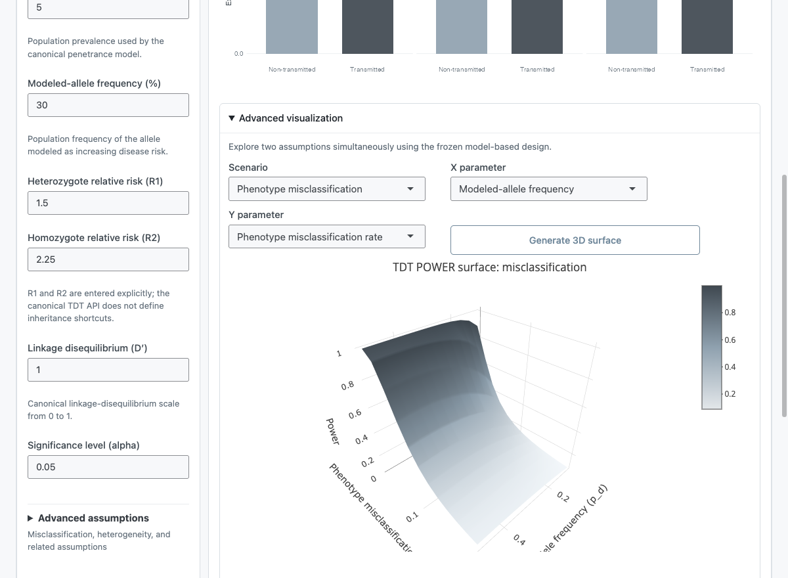
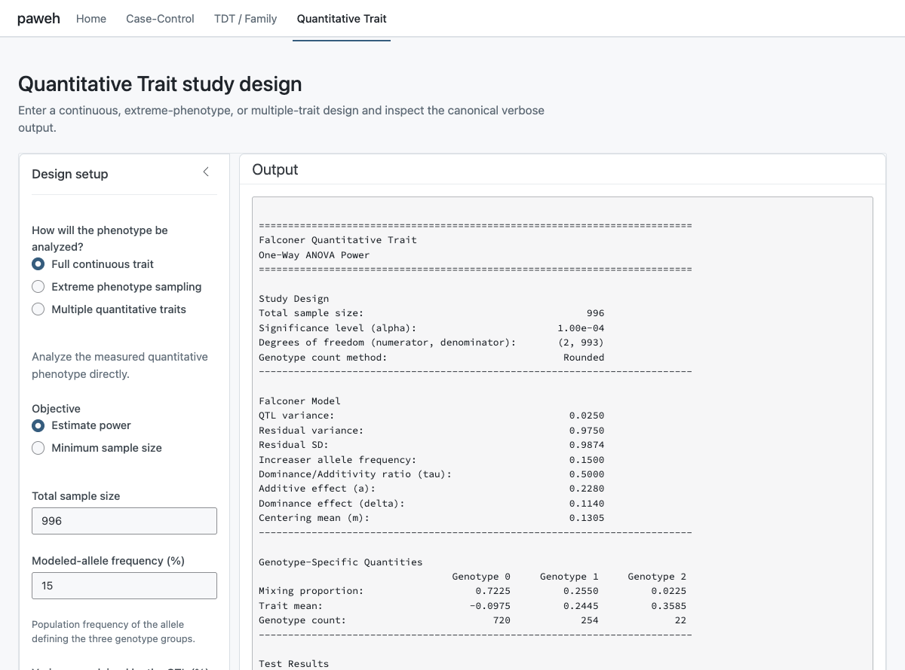
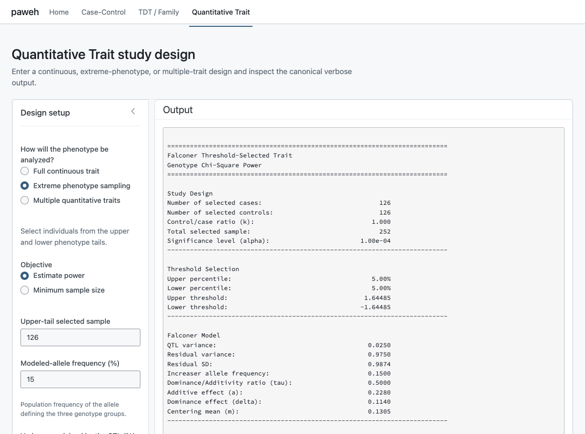

```{r setup, include=FALSE}
knitr::opts_chunk$set(collapse = TRUE, comment = "#>", fig.width = 7, fig.height = 5)
library(paweh)
```

# Choose the study you can recruit

A clinic can recruit 500 patients and 500 unaffected controls. Is that enough
to detect a difference in their genotypes? A family registry has a different
question: how many affected children **and their parents** are needed? A
growth study may instead have one height measurement per person. The first
decision in the dashboard is which of these studies you are planning.

The dashboard lets you enter a design, read the answer and try another
assumption without writing R code. It calls the same public `paweh` functions
you would use in a script. All three workspaces are **prospective**: you
supply a difference worth detecting and assumptions about the people you
expect to recruit. **Power** is the chance that a repeated study would detect
that difference if those assumptions hold. **Minimum sample size** works
backwards from a target power to the recruitment needed. Neither calculation
tells you whether an association exists in a dataset.

## Install, open and stop the app

To follow this guide with the version on the personal GitHub repository's
`develop` branch, run the first block once. Suggested packages include
`plotly` for the optional family-study surface. Building the offline
vignettes also needs Pandoc, which is included with RStudio.

```{r install-dashboard, eval=FALSE}
# If needed: install.packages("remotes")
remotes::install_github("akilanthony/paweh", ref = "develop",
                        dependencies = TRUE, build_vignettes = TRUE)
```

Run the next block in an interactive R session. `paweh_app()` constructs
an application object; `shiny::runApp(app)` starts it. Use the URL printed
in the R console if the viewer does not open. Stop the app to return to the
R prompt (the stop button in RStudio, or Ctrl+C in a terminal). Reading or
building this vignette does not start a server.

```{r launch-dashboard, eval=FALSE}
library(paweh)
app <- paweh_app()
shiny::runApp(app)
```

```{r shiny-home, echo=FALSE, out.width="100%", fig.alt="Home has three buttons: Open Case-Control, Open TDT / Family and Open Quantitative Trait.", fig.cap="Start with how participants will be sampled and measured. The same three workspaces are available in the top navigation."}

```

Choose **Open Case-Control** for unrelated cases and controls, **Open TDT /
Family** for transmissions within families, or **Open Quantitative Trait**
for measured traits such as height. [Sequencing designs](paweh-06-sequencing-study-design.html)
and [LRTae validation designs](paweh-07-lrtae-study-design.html) are
available in R; neither has a dedicated dashboard workspace.

## How to read any workspace

1. Choose the study family. Under **Design setup**, choose **Estimate power**
   if you know the sample size, or **Minimum sample size** if you know the
   power you want.
2. Enter the assumptions. Fields marked **(%)** take percentages: enter 30
   for 30%. **Significance level (alpha)** takes a probability: enter 0.05
   for a nominal 5% false-positive rate under no association.
3. Select **Calculate study design**. Scroll down the setup panel if needed.
   Read **Results** for Case-Control or TDT / Family; read **Output** for
   Quantitative Trait.
4. Try a different assumption. The first two workspaces have a **Sensitivity**
   tab; for quantitative traits, record the first answer, edit the input and
   calculate again.
5. Save a calculation worth keeping. Case-Control and TDT / Family generate a
   **Reproduce in R** block. The height example below shows the equivalent
   handwritten call for Quantitative Trait.

**Inputs and results can refer to different designs.** Editing the form
does not recalculate. The previous answer stays visible, with a notice to
recalculate. This lets you finish changing several related assumptions
without mistaking a partly edited design for a result. For Case-Control and
TDT / Family, the plots and generated code use the last *calculated* design
as well. Select **Calculate study design** again before recording an answer
for the edited inputs.

# Case-Control: will 500 cases and 500 controls suffice?

Suppose a clinic expects the modeled allele (one version of a DNA sequence)
to have a population frequency of 30%. People with two copies are assumed to
have twice the disease risk of people with none. The team wants at least 80%
power. Open **Case-Control**, choose **Estimate power** and **Genetic model**,
and enter the following values. Leave the boxes under **Advanced assumptions**
unchecked for the first calculation.

| Dashboard field | Enter | Corresponding argument in `cc_power()` |
|:--|:--|:--|
| Number of cases | 500 | `N_case = 500` affected people |
| Controls per case | 1 | `k = 1`: 500 unaffected controls, **1,000 people total** |
| Disease prevalence (%) | 10 | `prev = 0.10` in the source population, not the fraction of recruited cases |
| Modeled-allele frequency (%) | 30 | `pd = 0.30` of allele copies, not 30% of people |
| Inheritance model | Multiplicative | `MOI = "M"`: each additional copy multiplies risk by the same factor |
| Homozygote relative risk | 2 | `R2 = 2`; the one-copy relative risk is therefore the square root of 2 |
| Significance level (alpha) | 0.05 | `alpha = 0.05` for each test considered |

Select **Calculate study design** and read **Interpretation** on **Results**.
Open **Advanced calculation details** and find **Statistical result details**
for the percentages to two decimal places. The **genotype chi-square** test
asks whether the distribution across zero, one and two copies differs in any
way between cases and controls. The **trend** test asks about a systematic
change with allele count, using one degree of freedom instead of two.

```{r cc-example}
cc_design <- cc_power(
  N_case = 500, alpha = 0.05, input_mode = "model_based",
  prev = 0.10, pd = 0.30, R2 = 2, MOI = "M", k = 1, verbose = FALSE
)
cc_table <- data.frame(
  test = c("Genotype chi-square", "Trend"),
  power = c(cc_design$tests$genotypes$power, cc_design$tests$trend$power)
)
knitr::kable(cc_table, digits = 5, col.names = c("Test", "Power"))
```

Both exceed 80%. In 100 studies like this one, the genotype test would detect
the assumed difference about 96 times, and the trend test about 98 times.
The ordered difference suits a trend test here; it need not be the better
choice for another inheritance pattern. Plan for the test you intend to use.

```{r shiny-cc-results, echo=FALSE, out.width="100%", fig.alt="Expanded case-control details show model assumptions, case and control genotype probabilities, power of 96.19% and 98.22%, and the corresponding cc_power call.", fig.cap="Compare the model on the left with the last calculation on the right. Statistical result details and Reproduce in R are near the bottom of the expanded panel."}

```

## What if allele frequency is uncertain?

Select **Sensitivity**, choose **Allele frequency** under **Parameter**, set
**Range** to approximately 0.20–0.40, and select **Run sensitivity analysis**.
Here the horizontal axis uses fractions (0.30 is the sidebar's 30%). The
vertical axis shows power for each test at each candidate frequency; the
dotted vertical line marks the frozen design's 0.30. The case count,
allocation, risk model, prevalence and alpha stay fixed. Near 0.20 the
genotype test has about 91% power, versus 96% at 0.30. A tightly zoomed
vertical scale can make that difference look larger: read the tick values.

These curves are **not confidence intervals**. Each point answers a new
design question with a deliberately chosen input. Under **Minimum sample
size**, the vertical axis instead reports the required total number of
people. **Visualize** shows the calculated genotype distributions;
**Methods** identifies the test and function.

To examine measurement errors or disease due to other loci, open **Advanced
assumptions**, choose the relevant mechanism, enter its rates, and calculate
again. Case-control heterogeneity uses the percentage of disease
**attributable** to the modeled locus. A requested phenotype error, genotype
error or heterogeneity scenario is compared separately with the same
no-error baseline. Turning on several boxes does not estimate their joint
effect. The [case-control tutorial](paweh-02-case-control-study-design.html)
works through recruitment and these mechanisms in detail.

# TDT / Family: what if some enrolled children are misclassified?

A family registry can recruit **600 complete trios**: 600 affected children
and both biological parents of each child, or **1,800 people**. The
transmission disequilibrium test (TDT) asks whether an allele is transmitted
to affected children more often than expected from informative parents.
An unaffected control group is not needed.

1. Open **TDT / Family**, choose **Estimate power** and **Genetic model**.
   Enter 600 for **Number of affected-child trios**, 5 for **Disease
   prevalence (%)**, and 30 for **Modeled-allele frequency (%)**.
2. Enter **Heterozygote relative risk (R1)** = 1.5 and **Homozygote relative
   risk (R2)** = 2.25. These compare one and two copies with zero copies.
   Enter 1 for **Linkage disequilibrium (D′)** and 0.05 for **Significance
   level (alpha)**. D′ describes how strongly the marker and disease allele
   travel together; 1 specifies the maximum positive association given the
   model's allele frequencies.
3. Leave **Advanced assumptions** off and select **Calculate study design**.
   **Results** gives 99.7% power for the no-error design.
4. Open **Advanced assumptions**. Check **Phenotype misclassification** and
   enter 2 for **Control-to-affected misclassification rate (%)**. This
   means 2% of truly unaffected children are classified as affected, not
   that 2% of recruited children are unaffected. Check **Locus heterogeneity**
   and enter 20 for **Locus heterogeneity rate (%)**: in that alternative
   scenario, 20% of affected trios have disease unrelated to the modeled
   locus. Select **Calculate study design** again.

```{r tdt-example}
family_design <- tdt_power(
  N = 600, alpha = 0.05, input_mode = "model_based",
  prev = 0.05, pd = 0.30, R1 = 1.5, R2 = 2.25, delta_prime = 1,
  misclass_rate = 0.02, heter_rate = 0.20, verbose = FALSE
)
unlist(family_design$power)
```

Read across **three separate plans**: the same 600 trios give 99.67% power
at baseline, 91.98% with phenotype error alone, and 96.29% with locus
heterogeneity alone. Both mechanisms weaken the expected transmission
imbalance. The decreases are about 7.7 and 3.4 **percentage points**; do
not add them or treat the last row as a combined model. To work backwards
from a target, choose **Minimum sample size**, set **Target power (%)**, and
calculate again. The resulting recruitment unit is still complete trios.

```{r shiny-tdt-modifiers, echo=FALSE, out.width="100%", fig.alt="TDT Results shows 600 trios in each of three cards: no-error 99.7%, phenotype misclassification 92.0%, and locus heterogeneity 96.3%.", fig.cap="Read each adjusted card against No-error design. Each changes one assumption while keeping the 600-trio recruitment fixed."}

```

## Vary one family assumption, then two

Keep the power design above. Under **Sensitivity**, choose the phenotype
misclassification rate, set a **Range** and select **Run sensitivity
analysis**. Moving right increases the assumed error rate; moving down
means less power. Only the phenotype-error scenario depends on that rate.
For a minimum-size design, a rising curve instead means more trios must
be recruited.

Under **Visualize**, the first chart shows expected transmission and
non-transmission. To see a surface, expand **Advanced visualization**.
Select **Phenotype misclassification** under **Scenario**,
**Modeled-allele frequency** under **X parameter**, and **Phenotype
misclassification rate** under **Y parameter**. Then select **Generate 3D
surface**. Height shows power for that pair of assumptions. Drag to rotate
the surface. It is generated on request, using the last calculated design;
opening the tab alone does not generate it. This option needs the suggested
`plotly` package and a genetic-model design.

```{r shiny-tdt-3d, echo=FALSE, out.width="100%", fig.alt="Expanded Advanced visualization shows phenotype misclassification, modeled-allele frequency and error rate selectors, and the generated three-dimensional power surface.", fig.cap="The surface below the controls varies two assumptions. The transmission bars above it describe just the frozen design."}

```

## When the error is in the genotype call

The control **Genotype misclassification (Chapter 5)** refers specifically
to Gordon, Finch and Kim (2020), *Heterogeneity in Statistical Genetics*,
Chapter 5, §5.2.5. It uses a single rate for errors between adjacent genotype
categories and checks whether the called child and parent genotypes are
consistent with inheritance. It is not a general model for all laboratory
errors.

Use **Genetic model** and **uncheck both** phenotype misclassification and
locus heterogeneity first. Check **Genotype misclassification (Chapter 5)**,
enter 1 for **Genotype misclassification rate (%)**, and calculate. The
dashboard accepts 0–50%; 1 means `genotype_misclassification_rate = 0.01`
in R. With the 600-trio assumptions above, power is 99.17% at the nominal
cutoff. The calculation is conditional on retained, inheritance-consistent
trios; see the [TDT tutorial](paweh-03-tdt-study-design.html) for retention
and the effect on the false-positive rate. **Direct transmission quantities**
do not specify the full trio genotypes this model needs. Neither the
one-parameter sensitivity plot nor the advanced surface is supplied for
an active genotype-error scenario.

# Quantitative Trait: how many people should a height study measure?

Suppose height is measured on unrelated participants and a quantitative
trait locus (QTL) is expected to explain 2.5% of its population variance.
The question is whether average height differs across the three genotype
groups. Open **Quantitative Trait**. This workspace has an **Output** card
that prints the canonical R calculation, including its inputs and result.

1. Under **How will the phenotype be analyzed?**, select **Full continuous
   trait**, then **Estimate power**. Enter **Total sample size** = 996.
2. Set **Modeled-allele frequency (%)** to 15 and **Variance explained by the
   QTL (%)** to 2.5. The second number is a share of variation *between
   people's heights*, not a 2.5% change in a person's height. Enter 0.5 for
   **Dominance parameter**: the one-copy mean is displaced from the midpoint
   of the two homozygote means by half their additive half-difference.
   At zero the three genotype means would be equally spaced.
3. Enter 0.0001 for **Significance level (alpha)**. Under **Advanced
   assumptions**, keep **Genotype-count method** set to **Rounded**.
   Select **Calculate study design**. Check the sample size and alpha at
   the top of **Output**, then read **Power** under **Test Results**.

```{r height-power}
height <- qtl_anova_power(
  N = 996, alpha = 0.0001, pd = 0.15, qtl_var = 0.025, tau = 0.5,
  count_method = "rounded", verbose = FALSE
)
height$power
```

Power is **0.800048**, or about 80%: this design just meets the target.
Select **Minimum sample size**, enter 80 for **Target power (%)**, retain
the same trait assumptions and leave **Restrict sample size to multiples
of three** checked. Recalculate: **Minimum total sample size** is **996
individuals** on this search grid, not 996 in each genotype group.
If a pilot suggests the locus explains less variance, reduce that field
and recalculate before settling on a recruitment number.

```{r shiny-qtl-continuous, echo=FALSE, out.width="100%", fig.alt="Full continuous trait selected; the Output card identifies one-way ANOVA, total sample size 996, alpha 0.0001 and rounded genotype counts.", fig.cap="Start by checking the Study Design section in Output. Scroll through the printed report to Test Results for power."}

```

## If only the tallest and shortest people will be genotyped

Choose **Extreme phenotype sampling** and **Estimate power**. Enter 126 for
**Upper-tail selected sample**. Re-enter the same frequency, variance,
dominance and alpha as above. Set **Upper population tail selected (%)** and
**Lower population tail selected (%)** to 5, and **Lower-tail selected per
upper-tail selected** to 1 under **Advanced assumptions**. Select
**Calculate study design**. These cutoffs select extremes relative to the
population; the ratio determines how many of each extreme enter the test.

```{r height-extremes}
tails <- qtl_threshold_chisq_power(
  N_case = 126, k = 1, alpha = 0.0001, pd = 0.15,
  qtl_var = 0.025, tau = 0.5, x_upper = 5, x_lower = 5, verbose = FALSE
)
c(selected = tails$N_total, power = tails$power)
```

Here the printed “cases” are the upper tail and “controls” the lower tail:
126 of each, **252 genotyped people** and **80.17% power**. More people must
have their height measured to find those extremes. In R, `x_upper` and
`x_lower` take **percentages** (5), whereas `qtl_var` and `pd` take
**fractions**. Try a wider tail and recalculate to see how changing
selection changes power for the same number genotyped.

<details>
<summary>See the extreme-sampling Output card</summary>

```{r shiny-qtl-extreme, echo=FALSE, out.width="100%", fig.alt="Extreme phenotype sampling output lists 126 selected cases, 126 selected controls, total 252 and 5% upper and lower tails.", fig.cap="The count in Study Design is the number selected from the tails, not the number screened for height."}

```

</details>

## If several traits are measured on each person

Choose **Multiple quantitative traits** for, say, height and arm span
measured on the same people. The form offers two to four traits. Specify
one QTL variance and dominance ratio per trait, a shared allele frequency,
and a correlation for each pair. The **Phenotype correlations** fields
represent correlations *within genotype groups*; together they must form
a positive-definite correlation matrix.

**Joint continuous-trait test (Pillai MANOVA)** uses the complete measurements
to compare the groups' mean vectors. **Joint extreme-selection test** is
intended for people who meet all the upper cutoffs or all the lower cutoffs;
it needs upper and lower percentages for each trait and the selected-sample
ratio. Check the selected option and the heading in **Output**. In the
current dashboard the joint selector can revert to Pillai when the form
refreshes. If it does, use `qtl_multivariate_power_full()` or
`qtl_multivariate_mssn_full()` with `test = "threshold_chisq"` for the
joint-tail design. Do not read a Pillai result as a joint-tail result.

There are no **Results**, **Sensitivity**, **Visualize**, **Methods** or
generated-code panels in this workspace. The [quantitative-trait
tutorial](paweh-04-quantitative-trait-study-design.html) includes complete
multivariate calls, genotype-specific distributions and plots of selection
thresholds.

# Keep the calculation with the protocol

In **Case-Control** or **TDT / Family**, open **Results** → **Advanced
calculation details** → **Reproduce in R**. Copy the call into a script
after `library(paweh)`. The case-control and family calls above are runnable
equivalents of the generated calls. For a height study, save the corresponding
QTL call yourself; use `verbose = TRUE` to print its dashboard-style report.
Record the package version (`packageVersion("paweh")`), the sampling unit
and the source of each assumption. A colleague can then reproduce a number
in a protocol or manuscript, or change one assumption for a sensitivity
analysis without re-entering the whole study.

# Frequently asked questions

**I changed a field. Which answer am I looking at?** Until you select
**Calculate study design**, you are looking at the last calculation.
In QTL, the notice reads “Inputs have changed. Recalculate to update
output.” Check the printed assumptions as well as the form.

**Why are there two case-control answers?** The genotype and trend tests ask
different questions about the same people. Find both under **Advanced
calculation details** if a results card is not visible. Choose the analysis
before examining study data.

**What counts as one unit?** Case-control power starts from cases and
adds controls according to the ratio. TDT counts complete trios, so multiply
by three for the corresponding people. Full-trait QTL counts measured
individuals; a tail design counts the people selected for genotyping.

**What does an infinite minimum sample size mean?** If the assumed groups
do not differ, recruiting more of them does not create an association. For
example, equal expected transmitted and non-transmitted counts give no TDT
signal to detect. Check the effect assumptions before interpreting `Inf`.

**Why can't I see the 3D plot or a combined-error curve?** A family surface
requires a calculated genetic-model design, `plotly`, two distinct axes
and **Generate 3D surface**. The genotype-error branch does not offer it.
The phenotype-error and heterogeneity curves each change a different
assumption relative to baseline; they do not describe both operating at once.

**Can I upload genotypes or test whether my variant is associated?** No.
The dashboard takes planning assumptions, not participant records or genomic
files. A high power estimate describes a proposed test under an assumed
effect. It is neither an observed p-value nor proof of association.

# Sources and further reading

The [Getting Started guide](paweh-01-getting-started.html) introduces power
and recruitment. The scientific sources depend on the workspace and question:

- For case-control genotype error, see [Gordon et al. (2002)](https://doi.org/10.1159/000066696)
  and the [case-control tutorial](paweh-02-case-control-study-design.html).
- For family studies, [Buyske et al. (2009)](https://doi.org/10.1159/000194981)
  address phenotype error and [Chen et al. (2009)](https://doi.org/10.2202/1544-6115.1501)
  address locus heterogeneity. Gordon, Finch and Kim (2020),
  [*Heterogeneity in Statistical Genetics: How to Assess, Address, and Account
  for Mixtures in Association Studies*](https://doi.org/10.1007/978-3-030-61121-7),
  Chapter 5, §5.2.5, is the source behind the genotype-error control.
- For selecting quantitative-trait extremes, see [Li et al. (2019)](https://doi.org/10.1038/s41598-019-51790-w)
  and the [quantitative-trait tutorial](paweh-04-quantitative-trait-study-design.html)
  for its distinction between single-trait and joint selection.

<details>
<summary>R session used to render this guide</summary>

```{r session-info, echo=FALSE}
sessionInfo()
```

</details>
